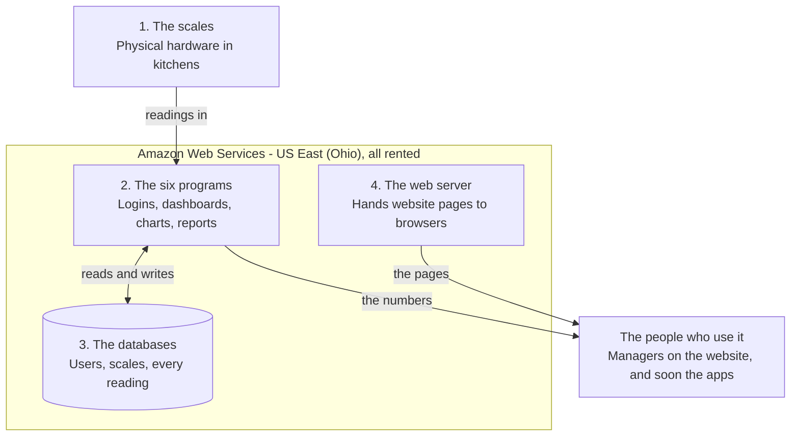
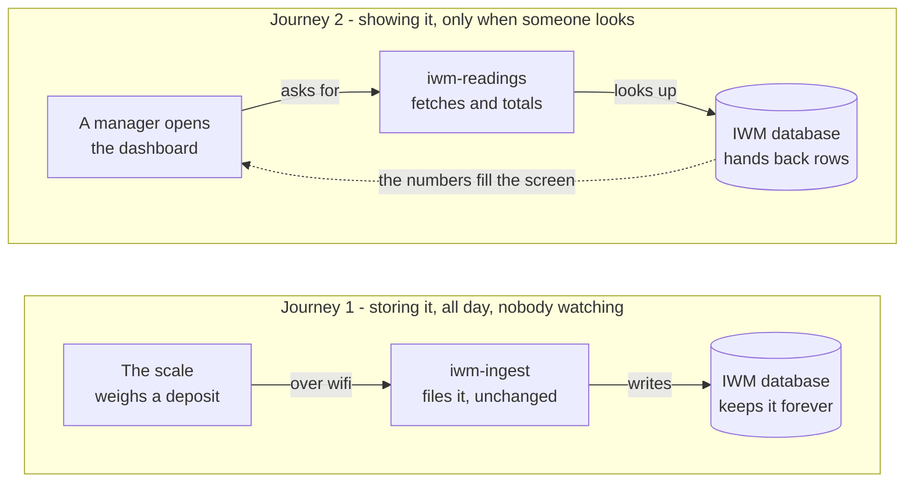

# IWM Smart Scale — Handover Guide

**Everything you need to run, fix, or hand on this system — written for someone starting from zero.**

Last updated: 11 October 2026

---

## Start here

This guide assumes you know nothing about software, servers or programming. Every technical word is explained the first time it appears, and again in the glossary at the end.

You are reading this because you now look after a system called **IWM Smart Scale**. Somebody built it, and that person is no longer the one running it.

### Read these two sections first

If you only have ten minutes, read [What this system does](#what-this-system-does) and [The accounts and keys you must take over](#the-accounts-and-keys-you-must-take-over).

The second one is urgent. This system is held together by about a dozen online accounts and passwords. If any of them are lost, parts of the system cannot be recovered at all — not by paying someone, not by Amazon, not by anyone. That section lists exactly which ones.

### What you are actually responsible for

Three things keep running whether anyone is watching or not:

1. **The scales** in kitchens keep weighing food waste and sending numbers.
2. **The website** at foodloss.ca keeps showing those numbers.
3. **The monthly bill** from Amazon keeps arriving.

If all three are fine, nothing needs doing. This system has no daily maintenance.

### You do not need to become a programmer

You need to be able to do three things:

- Know whether something is broken, and describe it accurately
- Hold the accounts and keys safely
- Hire or instruct a developer when a change is needed, and know enough to tell whether they are doing it properly

The section [If you are hiring someone](#if-you-are-hiring-someone-to-take-this-over) covers the third one.

### A note on the word "cloud"

When people say this system "runs in the cloud", they mean it runs on computers owned by Amazon, in buildings in Ohio, that we rent by the minute. There is no physical machine of ours anywhere. If the office burned down, this system would keep running.

That is why the accounts matter so much. The accounts *are* the system. Losing the password is the same as losing the machine.

---

## What this system does

**IWM Smart Scale helps commercial kitchens see how much food they throw away.**

IWM stands for Innovative Waste Management. The customers are restaurants, university cafeterias and other places that cook at scale, mostly in Canada.

### The idea

A kitchen does not know how much food it wastes. Staff scrape plates into a bin, the bin gets emptied, and nobody counts anything.

So IWM puts a **weighing scale** under the waste bin. Every time something is thrown in, the scale notices the weight go up and records it. Those weights travel over the kitchen's wifi to our system. Managers then open a website and see what their kitchen threw away — today, this week, by meal time, by location.

Once you can see it, you can reduce it. That is the whole product.

### What one scale sends

Each scale has a name, called a **UID** — for example `DALAC001` (a Dalhousie University location) or `GUELPH04`. Every time it records something, it sends a small message containing:

| Field | Meaning |
| --- | --- |
| UID | Which scale this came from |
| Date and time | When the scale's own clock says it happened |
| Per deposit weight | How much was just thrown in, in kilograms |
| Running total weight | The total on the scale since it was last emptied |
| Messages | Status notes such as "Bin Dumped", "System Tared" or "Wifi Reconnected" |

That is all. The scales do not record video, audio, names, or anything about people. They weigh things.

### What the website shows

A manager signs in with an email address and password and sees only the scales assigned to them. An administrator sees everything. The main screens are:

- **Dashboard** — what happened today and this week, which scales are reporting, and anything that needs attention
- **Analytics** — patterns over longer periods: which days and meal times produce the most waste
- **Reports** — downloadable PDF and Excel files for a chosen date range
- **Settings** — the manager's own profile, password, and meal-time schedule
- **Scale Management** and **User Management** — administrator only: registering scales, assigning them to people

### Who uses it

There are two kinds of account:

- **Client** — a kitchen manager. Sees their own scales only. Can create their own account.
- **Admin** — IWM staff. Sees everything, registers scales, assigns them to clients, deletes data. Admin accounts cannot be created through the website; they are made manually, on purpose, so nobody can give themselves admin access.

---

## The four pieces

**Only the scales are hardware you own. Everything in the middle is rented from Amazon by the minute.**



The only physical thing IWM owns is the scales. The three parts in the middle are rented from Amazon and can be rebuilt from this code if they are ever lost — which is exactly why the accounts, and not the machines, are what must be protected.

A useful way to hold it in your head: the **scales** are the staff writing notes, the **databases** are the filing cabinets, the **programs** are the clerks who fetch and total things up when asked, and the **web server** is the front desk that hands visitors the forms.

---

## The accounts and keys you must take over

**This is the most important section in the document. Do this part first.**

The system is not a thing you own. It is a set of rented services, and your proof of ownership is a set of logins. Whoever holds these logins controls the system. Whoever loses them cannot get it back.

### Step one, today

Get every item in the table below into a **password manager** — 1Password, Bitwarden and Dashlane are the usual choices, and they cost a few dollars a month. A shared spreadsheet or a notes file is not good enough, because these are the keys to customer data.

Make sure **at least two people** in the organisation can reach them. A single person holding everything is one lost phone away from losing the business.

### The list

| What | What it controls | If you lose it |
| --- | --- | --- |
| **Amazon Web Services account** | Everything. The server, the programs, all the data | Amazon can recover it with proof of identity and billing, but it is slow and painful |
| **Domain registrar login** (where foodloss.ca was bought) | The address foodloss.ca | The domain lapses and someone else can buy it |
| **The server key file** `iwm-key.pem` | Direct access to the web server | Cannot be re-downloaded. You would have to rebuild the server |
| **JWT_SECRET** | The signing key for user logins | Everyone gets signed out. Replaceable, but it must match across programs |
| **GitHub account** (`Lonewolfreturns/IWM`) | The source code | The code is also on the developer's computer — but do not rely on that |
| **An administrator account** on foodloss.ca itself | Day-to-day admin: scales, users, data | Recoverable only by someone with AWS access |
| **Android signing keystore** (`iwm-release.jks`) | Updating the Android app | **Unrecoverable.** See the warning below |
| **Google Play developer account** ($25 once) | Publishing the Android app | Recoverable through Google support |
| **Apple Developer account** ($99/year) | Publishing the iPhone app | Recoverable through Apple support |

### Three warnings worth reading twice

**The Android keystore cannot be replaced.** It is a small file that proves an app update really came from you. Google checks it on every upload. If it is lost, the app can never be updated again — the only option is to publish a brand-new listing and ask every user to delete the old app and install the new one. Back it up in at least two places.

**The server key file cannot be re-downloaded.** Amazon shows it to you once, when the server is created. If it is gone, you cannot log into the server to change anything. The website keeps running, but it is frozen.

**The Apple Developer account renews yearly.** If the $99 is not paid, the iPhone app is removed from the App Store. Put the renewal date in a calendar.

### Where to find them right now

The values themselves are deliberately not written in this file — it is in a public-facing code repository.

- `JWT_SECRET` is visible in the AWS console: **Lambda → iwm-auth → Configuration → Environment variables**
- The web addresses the apps talk to are in `frontend/.env` on the developer's computer, which is not saved to GitHub on purpose
- The server key file lives wherever it was downloaded, usually a `.ssh` folder
- The keystore does not exist yet — it is created the first time the Android app is published

### Still to be set up

A **monitored support mailbox**. The mobile apps and the privacy page both need a working address where customers can write, particularly for account deletion requests, and both app stores check that it is real and answered. One has not been decided yet. See [Unfinished work](#unfinished-work-and-known-quirks).

### Billing

The Amazon account needs a working credit card. If the card expires, Amazon sends warnings for a while and then suspends the account, which takes the website and the scales offline together. Make sure the billing alerts go to an address somebody reads.

---

## Amazon Web Services, explained from zero

**Everything except the physical scales runs on Amazon Web Services. We rent computing by the minute instead of owning machines.**

### What AWS actually is

Amazon Web Services (AWS) is Amazon's other business. Alongside the shop, Amazon owns enormous buildings full of computers and rents them out in small slices.

Think of it as a very large commercial kitchen you can rent by the hour. You do not buy the ovens. You book the oven you need, use it, and pay for the minutes. If you need ten ovens next Tuesday, you book ten.

AWS sells roughly two hundred different services. This project uses seven. You can ignore the other hundred and ninety-three.

### One thing that catches everyone out: the region

AWS runs these buildings in dozens of places around the world, called **regions**. Everything in this project lives in one region: **US East (Ohio)**, written as `us-east-2`.

This matters because the AWS website only shows you one region at a time. If you log in and your things seem to have vanished, you are almost certainly looking at the wrong region. There is a region selector in the top-right corner of every AWS page. Set it to **Ohio** and everything reappears.

This is the single most common source of panic for someone new to an AWS account.

### The seven services we use

| Service | What it does here | Plain-English version |
| --- | --- | --- |
| **EC2** | Runs the website at foodloss.ca | A rented computer that is always switched on |
| **Elastic IP** | Gives that computer a permanent address | A street number that does not change when the building is renovated |
| **Route 53** | Turns "foodloss.ca" into that address | The phone book |
| **Lambda** | Runs the six small programs that do the actual work | Staff you pay per task, not per hour |
| **DynamoDB** | Stores users, scales and every reading | Three filing cabinets |
| **CloudWatch** | Records what every program did | The security camera and the logbook |
| **IAM** | Decides which program may touch which data | The keyring and the rules about who holds which key |

### EC2 — the rented computer

Our instance is a `t3.micro` running **Amazon Linux 2023**. "Instance" is AWS's word for one rented computer. `t3.micro` is one of the smallest and cheapest sizes, which is right here: this computer only hands out pre-built web pages, it does no heavy thinking.

On it are two pieces of software worth knowing by name:

- **nginx** (pronounced "engine-x") — the program that actually answers when a browser asks for a page. It is the receptionist.
- **certbot** — renews the security certificate that puts the padlock in the browser's address bar. It runs automatically every 60 days.

### Lambda — programs with no computer

This is the idea most people find strange, and it is worth understanding because six of our eight moving parts are Lambdas.

Normally a program needs a computer that is switched on and waiting. Lambda removes that. You give Amazon the program, and Amazon runs it only at the exact moment someone asks for it — then shuts it down. You pay per request, measured in fractions of a cent.

The practical consequences:

- When nobody is using the site, these cost **nothing at all**
- There is no server to update, patch or reboot
- If a thousand people arrive at once, Amazon simply runs a thousand copies
- There is nothing to "restart" when something is wrong — you fix the program and upload it again

Each Lambda has its own web address, called a **Function URL**. It is a long, random-looking address ending in `.lambda-url.us-east-2.on.aws`. The website and the mobile apps call these addresses directly.

### DynamoDB — the filing cabinets

A database is an organised store of information. DynamoDB is Amazon's version. We have three tables, covered in their own section below.

Two things are true of it that matter to you:

- Everything stored in it is **encrypted automatically**. If somebody stole the physical hard drive, they would get nothing readable.
- It is also billed per use. A quiet month costs very little.

### CloudWatch — the logbook

Every time a Lambda runs, it writes a note about what it did into CloudWatch. When something breaks, this is where the answer is. You do not need to understand the notes to be useful — copying the red error lines and sending them to a developer is genuinely helpful.

### IAM — the keyring

IAM decides what is allowed to touch what: this program may read the readings table, that one may also delete from it. It is invisible when correct and baffling when wrong. If an error message mentions "AccessDenied" or "not authorized to perform", IAM is the cause.

---

## The six programs

**Each Lambda is a separate small program with one job. They were split up so a slow one cannot make a fast one slow.**

In the AWS console you find them under **Lambda → Functions**, with the region set to Ohio.

| Name | Job | You would touch it when |
| --- | --- | --- |
| `iwm-ingest` | Receives readings from the scales and files them away | Almost never — see the warning below |
| `iwm-auth` | Signing up, signing in, changing a password | Login is broken, or the signing key changes |
| `iwm-api` | Scales and user accounts: listing, registering, assigning | Scales or users behave oddly |
| `iwm-readings` | The dashboard: recent readings, live activity, alerts | The dashboard is wrong or empty |
| `iwm-analytics` | Every chart on the Analytics page | A chart is wrong |
| `iwm-reports` | Building PDF and Excel report contents | A report is wrong |

### Why six and not one

A year-long analytics query can take several seconds. The dashboard refreshes every fifteen seconds and must feel instant. If they shared one program, the slow one would hold up the fast one. Splitting them also means a fault in reports cannot take down logins.

### Read this before touching `iwm-ingest`

**The copy of `iwm-ingest` in this repository is not the version that is running.** The file carries a large warning at the top saying so.

The live version stores each scale's timestamp exactly as the scale sent it. The version here was written to convert those timestamps to a standard world clock instead. Both are reasonable designs, but the whole website is built around the first one.

If somebody uploads this version without a plan, new readings start being stored in a different format from the millions already there, and times across the site begin showing wrongly — gradually, which is worse than obviously.

**Practical consequence:** the code that is actually running for ingest exists only inside AWS, not in this repository. That is a real risk. A worthwhile early task for any developer you hire is to copy the live code out of the AWS console and save it here, so the repository matches reality.

### How the programs are updated

These are small, self-contained Python files with no external libraries. Updating one means opening the function in the AWS console, pasting in the new code, and pressing **Deploy**. There is no build step and nothing to install. Step-by-step instructions are in [Routine jobs](#routine-jobs-step-by-step).

### Settings live outside the code

Each program has **environment variables** — settings stored next to it rather than written into it, so they can change without touching code. They include the signing key, the table names, and the thresholds that decide when an alert fires.

You find them under **Configuration → Environment variables** on each function. The important one is `JWT_SECRET`, which must be **identical** on `iwm-auth` and every other program that checks logins. If they ever disagree, everybody is signed out and nobody can sign back in.

---

## The three databases

**Everything the system knows lives in three DynamoDB tables. Find them under DynamoDB → Tables, region set to Ohio.**

| Table name | Holds | Roughly how big |
| --- | --- | --- |
| `IWM` | Every reading from every scale, since the beginning | The large one, and it only grows |
| `iwm-users` | One record per person who can sign in | Small — tens of records |
| `iwm-scales` | One record per physical scale | Small — tens of records |

The inconsistent naming (`IWM` in capitals, the other two with a prefix) is historical. The readings table came first. It is not worth renaming — doing so would mean updating every program.

### `IWM` — the readings

One row per deposit. Each row is found by two things together: **which scale** (`UID`) and **when** (`DateTime`). That pairing is why the system can fetch "everything DALAC001 recorded last Tuesday" quickly without reading the whole table.

This table is append-only in normal use. Nothing edits a reading after it lands. An administrator can delete all readings for one scale from the Scale Management page, which exists for clearing out test data.

### `iwm-users` — the people

One row per account, found by email address. It holds name, email, phone, city, organisation, and whether the account is a client or an admin.

**Passwords are not stored.** What is stored is a *hash* — the result of scrambling the password through a one-way calculation. When someone signs in, their typed password is scrambled the same way and the two results are compared. The original cannot be worked backwards from the hash, even by us. Anyone who tells you they can "look up a user's password" has misunderstood the system.

The same is true of the security question answer.

### `iwm-scales` — the hardware

One row per scale, found by its UID. It holds the display name, location, time zone, which email addresses may see it, and the kitchen's meal-time schedule.

A scale can be assigned to **several people** — a manager and an assistant manager, for instance. A person sees every scale assigned to their email address.

### A scale can exist without a record

The two sides are joined by the scale's UID, and nothing forces them to match up. A scale that has been plugged in and is sending readings, but was never registered on the Scale Management page, still appears on the site — marked **unregistered**. That is intentional: a scale sending data should never be invisible just because the paperwork is late.

### What this costs and why it stays cheap

DynamoDB bills by how much is read and written rather than by how much is stored. A system with a few dozen scales reporting a few times an hour is a tiny customer. The bill grows with *use*, not with the size of the history — so years of accumulated readings stay inexpensive to keep.

---

## The website, the domain and the padlock

**foodloss.ca is a rented computer in Ohio with the finished website copied onto it.**

### The pieces, and how they connect

| Piece | Value | What it is |
| --- | --- | --- |
| Domain | `foodloss.ca` | The name people type |
| DNS | Route 53 hosted zone | The phone book entry pointing the name at the computer |
| Server address | `18.227.188.57` (Elastic IP) | The permanent street number |
| Server | EC2 `t3.micro`, Amazon Linux 2023 | The computer itself |
| Web software | nginx | Answers browser requests |
| Files | `/var/www/iwm` on the server | The actual web pages |
| Certificate | Let's Encrypt, renewed by certbot | The padlock in the address bar |

Two DNS records exist, so both `foodloss.ca` and `www.foodloss.ca` reach the same place.

### Why the Elastic IP matters

An ordinary AWS server gets a new address every time it is switched off and on. The phone book entry would then point at nothing, and the site would go dark for no obvious reason.

An **Elastic IP** is a reserved address that stays yours. It is already set up. The thing to know is: **do not release it.** If it is released, the address is gone and the DNS records must be redone.

### What the padlock is, and the one thing that can break it

The padlock means traffic between the visitor and the server is encrypted. The certificate proving it comes free from a service called **Let's Encrypt**, and it is deliberately short-lived — about 90 days.

A program called **certbot** renews it automatically. The current certificate runs to **8 December 2026**.

> **Open item.** Certbot's automatic renewal timer may not be switched on. If it is not, the certificate will quietly expire, and on that day every visitor gets a full-page red security warning instead of the site. This is the single most likely way for the website to break on its own. Fixing it is one command, listed in [Routine jobs](#routine-jobs-step-by-step). Worth confirming this month rather than in December.

### How the site gets updated

The website is not edited on the server. It is built on a developer's computer into a folder of finished files, and those files are copied up, replacing what was there.

The script `aws/deploy-frontend.ps1` does the whole thing: build, wipe the old files, copy the new ones, fix the permissions. Running it takes about a minute.

The permissions step is not optional and has caught people out before: the copy command creates folders that nginx is not allowed to open, so the site returns "403 Forbidden" until permissions are corrected. The script already handles this.

### One quirk worth knowing

The site is a **single-page application**. The browser downloads one page and then rewrites it as you navigate. The server is told to answer every address with that same page.

The consequence: visiting the site by its raw IP address or its long `ec2-...amazonaws.com` name correctly returns "404 Not Found". That is not a fault. Only `foodloss.ca` and `www.foodloss.ca` are configured to serve the site.

---

## How a reading reaches a screen

**Storing a reading and showing it are two separate journeys. The database is the only thing they share.**



This split is the most useful thing to understand about the system, because it explains most of the ways it can go wrong.

**Journey 1 runs on its own.** Scales report whether or not anyone is signed in, overnight, at weekends, forever. If this journey breaks, data is being *lost* — and that loss is permanent, because nothing replays it later.

**Journey 2 runs only when someone looks.** If this journey breaks, nothing is lost. The numbers are safe in the database and appear again as soon as it is fixed.

That is why a blank dashboard is annoying but not urgent, while a scale that has stopped reporting is urgent. The dashboard can be fixed tomorrow. A day of missing readings cannot be recovered.

The Analytics and Reports pages take the same shape as Journey 2, just with different programs doing the fetching.

---

## The Android and iPhone apps

**The apps are built and ready to compile, but neither has been published to a store yet.**

### What they are

Rather than writing two more apps from scratch, the existing website is **packaged inside** an app shell using a tool called **Capacitor**. The result is a real app you install from a store, with the website's screens inside it.

This matters for cost. One set of screens serves the website, the Android app and the iPhone app. A bug fixed once is fixed everywhere, and a new report appears in all three without being built three times. Writing separate native apps would have meant rebuilding the entire reports and charts system twice, in a way that would have to stay numerically identical forever.

Importantly, the apps do **not** just open foodloss.ca in a window. The screens are compiled into the app itself, so it opens instantly and does not need the website to be up. Apple rejects apps that are merely a website in a frame.

### What had to be added for the apps

Five things work on a website but not inside an app, and each needed real work:

| Thing | Why it broke |
| --- | --- |
| Downloading reports | An app has no "Downloads" folder, so every export silently did nothing. Now the file goes to the phone's normal share sheet — save to Files, email it, print it |
| Staying signed in | The usual browser storage is readable on a tampered phone. The login token now goes in the phone's hardware-protected vault |
| The Configure Scales link | It replaced the whole app with a website and left no way back. It now opens a proper in-app browser with a Done button |
| The Android back button | One press from a dialog closed the entire app. It now closes the dialog, then goes back a page, then minimises |
| Notches and rounded corners | The page title sat underneath the phone's clock |

### Where they stand

**Built and configured:** both app projects exist, with app icons, privacy declarations, security hardening, and screens laid out for phones and tablets.

**Not yet done:**

- Neither app has ever been compiled — the development computer is Windows, which cannot build an iPhone app at all
- Neither has been tested on a real phone
- Neither store account has been created
- The Android signing key does not exist yet

**Before publishing**, someone must install Android Studio and build the Android app, and use a Mac for the iPhone one. A cloud build setup is in `.github/workflows/mobile-build.yml` that can compile both without owning a Mac. Full details in [`aws/SETUP-MOBILE.md`](aws/SETUP-MOBILE.md).

### Account deletion — a store requirement

Both Apple and Google require that any app which lets people sign up also lets them delete their account, and that the option is reachable **inside the app**. An email address alone is not accepted.

This is handled as a request: the user taps **Settings → Password & Security → Request account deletion**, which opens a pre-filled email to the published support address. An administrator then deletes the account from the User Management page. There is also a public page at `foodloss.ca/delete-account` for people who have already uninstalled.

**A real support address must be chosen and monitored before the apps are submitted.** Both screens and the privacy page currently carry a placeholder, and both stores check that the address works. Requests must be actioned within 30 days, which is what those screens promise.

---

## What it costs to run

**Expect roughly US$15–25 a month at the current scale. The figures below are approximate — check the real bill.**

To see the real number: AWS console → **Billing and Cost Management** → **Bills**. Check it once a month.

### Approximate monthly costs

| Service | Approx. cost | Why |
| --- | --- | --- |
| EC2 server (`t3.micro`) | ~$7–8 | Billed per hour, always on. Free for the account's first 12 months |
| Elastic IP address | ~$3.60 | Amazon now charges for every public address, even one in use |
| Route 53 (domain records) | ~$0.50 + traffic | A flat fee per domain |
| Lambda (all six programs) | ~$0–1 | The first million requests each month are free, forever |
| DynamoDB (all three tables) | ~$1–5 | Billed by use, not by size of history |
| Data transfer out | ~$0–2 | The first 100 GB each month is free |
| Domain renewal (`foodloss.ca`) | ~$15–20 **per year** | Paid to the registrar, not to Amazon |

The Lambdas being effectively free is the point of the design. Six programs that cost nothing when idle is why a system this small is cheap to keep alive.

### Costs that arrive separately

| Item | Cost | When |
| --- | --- | --- |
| Google Play developer account | US$25 | Once, ever |
| Apple Developer Program | US$99 | **Every year.** The app is pulled from the store if unpaid |
| Password manager | ~$3–8/month | Strongly recommended — see the accounts section |

### What could make the bill jump

The realistic risks, roughly in order of likelihood:

1. **A programming mistake that loops.** A Lambda that accidentally calls itself can run millions of times in a day. This is the classic way to turn a $20 bill into a $2,000 one.
2. **Someone replacing the server with a bigger one.** Sizes go up steeply. A large instance can cost several hundred dollars a month.
3. **Switching DynamoDB to "provisioned" mode.** This reserves capacity whether used or not. The current pay-per-use setting is right for this workload.
4. **A second environment left running.** A copy made for testing and never switched off quietly doubles everything.

### Set a billing alarm — do this today

This takes five minutes and is the best protection you have.

1. Sign in to AWS
2. Search for **Billing and Cost Management**
3. Open **Budgets** → **Create budget**
4. Choose **Monthly cost budget**, set it to something like **$50**
5. Enter an email address that a person actually reads

Amazon will email you when spending passes the threshold. Without this, the first you know about a runaway cost is the credit card statement a month later.

---

## Routine jobs, step by step

**Most of these need no technical knowledge. The ones that do are marked.**

### Everyday admin, done on the website itself

No tools, no code. Sign in to foodloss.ca with an administrator account.

**Register a new scale.** Go to **Scale Management**, press **Add Scale**, and enter the scale's UID exactly as it is printed or configured on the device. Capitalisation matters less than it used to, but matching exactly is still safest. Then assign the people who should see it.

**Give someone access to a scale.** Scale Management → pick the scale → edit its assigned people. One scale can go to several people. Search the list rather than scrolling it.

**Handle an account deletion request.** When a request arrives at the support address:

1. Reply and confirm the request really came from the account holder. If they wrote from a different address, ask for something that proves the account is theirs.
2. Go to **User Management**, find the account, delete it.
3. Email them to confirm it is done.
4. Do this within **30 days** — that is what both app screens and the privacy policy promise.

**Clear out test data.** Scale Management has a purge option: choose a scale, type the confirmation word, and every reading for that scale is deleted. There is no undo. Only use it on scales you are certain are test units.

### Create an administrator account — *needs a developer*

Admin accounts cannot be created through the website, deliberately. There is a script, `aws/scripts/create_admin.py`, which asks for the details and writes the record directly into the database. It needs Python and AWS credentials set up on the computer running it.

### Update the website — *needs a developer*

One script does everything:

```
.\aws\deploy-frontend.ps1
```

It rebuilds the site, deletes the old files from the server, copies up the new ones and fixes permissions. It needs the server key file `iwm-key.pem` to be in place. Takes about a minute. The site is briefly unavailable while files are being replaced.

### Update one of the six programs — *needs a developer*

1. Sign in to AWS, set the region to **Ohio**
2. Go to **Lambda → Functions** and open the one you want
3. Open the file in the code editor on screen
4. Paste in the new contents, replacing everything
5. Press **Deploy**
6. Press **Test** or load the website and confirm it still works

There is no build step. Changes take effect within seconds. If something goes wrong, paste the previous version back the same way — so **keep a copy of what was there before you overwrite it**.

### Check the certificate will renew — *needs a developer, worth doing now*

Log into the server and check whether automatic renewal is switched on:

```
sudo systemctl status certbot-renew.timer
```

If it says `inactive` or `disabled`, switch it on:

```
sudo systemctl enable --now certbot-renew.timer
```

That is the whole fix. Without it, the certificate expires and the site shows a red security warning to every visitor.

### Log into the server — *needs a developer*

```
ssh -i "$env:USERPROFILE\.ssh\iwm-key.pem" ec2-user@ec2-18-227-188-57.us-east-2.compute.amazonaws.com
```

The username is `ec2-user`. A common mistake is trying `ubuntu`, which belongs to a different kind of server and will simply be refused.

---

## When something breaks

**First establish which half is broken: the website, or the programs behind it. They fail differently and have nothing to do with each other.**

### The two-minute triage

Open foodloss.ca in a browser.

- **Nothing loads at all, or a security warning fills the screen** → the *website server* is the problem.
- **The site loads, you can sign in, but data is missing or wrong** → one of the *six programs* is the problem.

That one distinction cuts the search roughly in half and is the most useful thing you can tell a developer.

### Symptom table

| What you see | Most likely cause | What to check |
| --- | --- | --- |
| Full-page red security warning | The certificate expired | Was the renewal timer ever switched on? |
| Nothing loads, connection times out | The server is stopped | AWS → EC2 → is the instance "running"? |
| "403 Forbidden" | File permissions after a deployment | Re-run the deploy script |
| "404 Not Found" on the plain IP address | Nothing — this is correct | Use foodloss.ca, not the IP |
| Site loads, but signing in fails for everyone | The signing key changed, or `iwm-auth` is broken | CloudWatch logs for `iwm-auth` |
| Signed in, but every panel is empty | A program is erroring | CloudWatch logs for `iwm-readings` |
| One chart wrong, everything else fine | `iwm-analytics` | CloudWatch logs for that function |
| Reports fail to download | `iwm-reports` | CloudWatch logs for that function |
| One scale missing from the dashboard | That scale has stopped sending | Is it powered? Is the kitchen wifi up? |
| Everything fine but the bill tripled | A program looping, or a second environment left on | Billing → Cost Explorer, grouped by service |

### The site is down

In order:

1. **AWS → EC2 → Instances.** Is it `running`? If it says `stopped`, start it. If it was stopped without anyone doing it, Amazon may have sent a maintenance email.
2. **Check the Elastic IP is still attached.** EC2 → Elastic IPs. If it has detached, the domain points nowhere.
3. **If the browser shows a security warning**, the certificate expired. A developer logs in and runs `sudo certbot renew`, then switches on the renewal timer so it cannot happen again.

### The site loads but the numbers are wrong

This is almost always one Lambda. To find out which:

1. Sign in to AWS, region **Ohio**
2. **CloudWatch → Log groups**
3. Find the group named after the function, for example `/aws/lambda/iwm-readings`
4. Open the most recent log stream
5. Look for lines containing `ERROR` or `Traceback`

You do not need to understand them. Copy those lines and the time they happened, and send them to a developer. That is a genuinely useful bug report and will save hours.

### A scale has gone quiet

The dashboard flags scales that have not reported in a while. Before assuming software:

- Is the scale powered on?
- Is the kitchen's wifi working?
- Has the kitchen's wifi password changed? This is the single most common cause.
- Was the scale unplugged and moved?

The scales are configured through a separate tool, linked in the website's menu as **Configure Scales**.

### What to say when you report a problem

A developer can work from this. Include:

- What you did, and what happened instead
- The exact time, with the time zone
- Which account you were signed in as, and whether it is admin or client
- Whether it happens for everyone or just one person
- Whether it happens on the website, the app, or both
- A screenshot of the whole screen, address bar included

---

## Unfinished work and known quirks

**Read this before touching anything. There is substantial work finished but not yet saved or published.**

### Finished but not yet live

These changes are written and tested but have not been pushed out, so the live site does not have them yet:

- [ ] Re-deploy the website so the fixes reach foodloss.ca
- [ ] Upload the updated `iwm-api` program (fixes scales appearing twice under different capitalisation)
- [ ] Upload the updated `iwm-analytics` program (fixes scale names being matched too strictly)
- [ ] Switch on the certificate auto-renewal timer on the server
- [ ] Choose and set up a real support address, then update the apps, the privacy page and the store listings

### Known quirks that will confuse the next person

**Scale clocks are not set.** Each scale has a time-zone setting on its record, and most are still blank. When blank, the system has to guess, and it guesses the fleet default — which is wrong by an hour for scales that are actually on Atlantic time. The timestamps shown are always exactly what the scale recorded; it is only the "reported 5 minutes ago" style figures that drift.

*The fix is not technical:* open each scale in Scale Management and set its time zone. There is a built-in Clock Check tool on that page that works out what clock a scale is really keeping, by looking at its activity pattern.

**Scale names are case-sensitive in places.** `GUELPH04` and `Guelph04` are the same physical scale but were once treated as two. Most of this is fixed, but it is the first thing to suspect if a scale ever appears twice or goes missing.

**The `iwm-ingest` program in this repository is not the live one.** Covered above. Do not upload it without a plan.

**The dashboard polls every 15 seconds and hides failures on purpose.** If a request fails, the previous numbers stay on screen rather than blanking out. This is deliberate — but it means a broken connection can look like live data that simply stopped changing. The mobile apps show an "offline" banner for exactly this reason; the website does not.

**Security updates are outstanding in the build tools.** Several supporting libraries used to *build* the website have known vulnerabilities. They do not run on the server or in anyone's browser, so the risk is low, but clearing them requires upgrading a major library version and is a half-day job.

### Things offered and never done

Not problems, just loose ends someone may wonder about:

- The programs accept requests from any website address rather than only from foodloss.ca. Tightening this is good practice.
- There is unused code left in the website for features that were removed.
- The apps could send push notifications when a scale goes quiet. This was designed but not built.

---

## The code: what lives where

**Two folders matter; the rest is leftovers.**

| Folder | What is in it |
| --- | --- |
| `aws/` | The six programs, the server configuration, the deployment script, and all the setup guides |
| `frontend/` | Everything a user sees — the website, and both mobile apps |

### Inside `aws/`

| Path | What |
| --- | --- |
| `lambdas/auth/` | Sign-up, sign-in, password changes |
| `lambdas/api/` | Scales and user accounts |
| `lambdas/readings/` | Dashboard data and alerts |
| `lambdas/analytics/` | The Analytics page |
| `lambdas/reports/` | Report contents |
| `lambdas/ingest/` | Receives from the scales — **not the live version** |
| `nginx/iwm.conf` | The web server's configuration |
| `scripts/create_admin.py` | Creates an admin account |
| `scripts/import_scales.py` | Bulk-registers scales |
| `deploy-frontend.ps1` | One-command website deployment |
| `SETUP-*.md` | Written guides for hosting, the apps, and each program |

### Inside `frontend/`

| Path | What |
| --- | --- |
| `src/pages/` | One file per screen: Dashboard, Analytics, Reports, Settings, and the rest |
| `src/components/` | Reusable pieces shared between screens — tables, cards, charts |
| `src/services/` | The code that calls the six programs |
| `src/lib/` | Shared logic: time handling, report building, Excel and PDF generation |
| `src/native/` | The five bridges that make the mobile apps work |
| `src/styles/` | Mobile-specific styling: notches, touch targets |
| `android/` · `ios/` | The two mobile app projects |
| `scripts/` | Helper tools: app icon generation, configuration checking |
| `.env` | The six web addresses of the programs. **Not saved to GitHub**, on purpose |

### Leftovers you can ignore

These are from earlier attempts and are not part of the running system. Nobody should spend time on them.

| Folder | What it was |
| --- | --- |
| `backend/` | An abandoned first attempt using different technology (FastAPI and MongoDB). Never deployed. Nothing refers to it |
| `tests/`, `test_reports/` | Test scaffolding from that same attempt |
| `deploment steps/` | Loose notes, with the folder name misspelled |

A sensible early task is to delete these, so the next person does not have to work out which half of the repository is real.

### A note on the code's comments

The code carries unusually long explanatory comments — often several paragraphs explaining why something is written the way it is, and what went wrong with the obvious approach.

This is deliberate and valuable. If a developer proposes a change and the code nearby has a comment explaining why it is not done that way, read the comment first. Several of them document bugs that were genuinely difficult to find.

---

## If you are hiring someone to take this over

**You are looking for one generalist web developer, not a team. This system is small.**

### What to ask for

The exact words to put in a job post or send to an agency:

> A full-stack JavaScript developer comfortable with React on the front end and Python on AWS Lambda on the back end, with hands-on AWS experience (EC2, DynamoDB, Route 53, CloudWatch). Mobile experience with Capacitor is a plus but not essential.

That is the whole skill set. Nobody needs to be an expert in all of it.

### Realistic expectations

| Work | Roughly |
| --- | --- |
| Getting oriented in the code | 1–2 days |
| A small change (wording, a column, a chart tweak) | Hours |
| A new report or screen | Days |
| Publishing the mobile apps to both stores | 1–2 weeks, mostly waiting on store review |
| Ongoing upkeep once stable | A few hours a month |

### Judging a candidate without being technical

You cannot assess their code. You can assess how they talk about it. Ask these and listen for the shape of the answer:

**"Read the comments at the top of `aws/lambdas/ingest/lambda_function.py` and tell me what you would do about it."**
A good answer notices the warning, says the live version must be copied out of AWS first, and does not propose uploading the file. Somebody who says "I'd just deploy it" has not read carefully enough to be trusted with this system.

**"How would you find out why one scale shows the wrong time?"**
You want to hear them ask questions — about the scale's time-zone setting, about what the device's own clock says — rather than immediately proposing a code change.

**"What would you do first?"**
The right answer is some version of *get the outstanding work deployed and the loose ends closed*. If they want to rewrite things before understanding them, keep looking.

### Three warning signs

- **"This should be rebuilt properly."** A working system with real customers is not rebuilt because a new developer prefers different tools. Sometimes a rewrite is right, but it is never the first thing to say.
- **Dismissing the code comments.** They document real bugs that took real time to find.
- **Wanting to move off AWS immediately.** The setup is unusually cheap and genuinely low-maintenance.

### Protect yourself on day one

1. **Never hand over your root AWS login.** Create them a separate user account with its own permissions, which you can switch off.
2. **Give GitHub access by invitation**, not by sharing your password.
3. **Keep the Android keystore yourself.** A developer needs it to publish; they do not need to keep a copy.
4. **Have them document as they go.** Add to the guides in `aws/`, which are already written in this style.
5. **Ask for a weekly summary in plain English.** If they cannot explain what they did without jargon, that is informative in itself.

### When you only need an hour

For the small outstanding items — switching on the certificate timer, uploading the two updated programs — you do not need to hire anyone permanently. These are a single short session for a competent freelancer, and this document tells them exactly what to do.

---

## Glossary

Every technical word used in this document, in plain English.

| Word | What it means here |
| --- | --- |
| **AWS** | Amazon Web Services. Amazon's business renting out computers and storage |
| **Backend** | The parts users never see: the programs and databases. Our six Lambdas |
| **Capacitor** | The tool that packages the website into real Android and iPhone apps |
| **certbot** | The program that automatically renews the website's security certificate |
| **Certificate** | The file that produces the padlock in a browser's address bar |
| **CloudWatch** | Amazon's logbook. Records what every program did, used for diagnosis |
| **Commit** | Saving a checkpoint of the code, with a note about what changed |
| **Database** | An organised store of information. Ours is DynamoDB |
| **Deploy** | To put new code live, so real users get it |
| **DNS** | The internet's phone book. Turns `foodloss.ca` into a numeric address |
| **DynamoDB** | Amazon's database service. Holds our users, scales and readings |
| **EC2** | Amazon's rented-computer service. Runs the website |
| **Elastic IP** | A permanent internet address that stays yours |
| **Environment variable** | A setting stored beside a program rather than inside it, so it can change without editing code |
| **Frontend** | Everything a user sees and clicks |
| **Function URL** | The web address that triggers one Lambda |
| **GitHub** | The online service where the code is stored and its history kept |
| **Hash** | A password scrambled by a one-way calculation. Cannot be unscrambled |
| **IAM** | Amazon's permission system. Decides which program may touch which data |
| **Instance** | One rented computer in AWS |
| **JWT / token** | The digital wristband proving you are signed in. Expires after 24 hours |
| **Keystore** | The file proving an Android app update genuinely came from you. **Irreplaceable** |
| **Lambda** | A program Amazon runs only when asked, charging per use |
| **Let's Encrypt** | The free service that issues our security certificate |
| **nginx** | The program on the server that answers browser requests |
| **Region** | Which part of the world your AWS things live in. Ours is Ohio (`us-east-2`) |
| **Repository / repo** | The folder holding all the code and its history |
| **SSH** | The secure way to log into the server and type commands |
| **Table** | One collection in the database, like one filing cabinet drawer |
| **UID** | The unique name of one physical scale, such as `DALAC001` |

### Things people confuse

**The website and the programs are separate.** The website is files on a rented computer. The programs run elsewhere, only when called. One can be broken while the other is fine.

**"The cloud" is not vague.** It is specific computers in specific buildings in Ohio, rented by the minute.

**A scale and its record are different things.** The physical scale sends readings whether or not anyone registered it. The record is the paperwork, and the system works without it.

**Deleting a user does not delete their readings.** Readings belong to the scale and the organisation that operates it, not to whoever could log in and look at them.

---

## Other documents in this repository

| File | What it covers |
| --- | --- |
| [`aws/SETUP-HOSTING.md`](aws/SETUP-HOSTING.md) | Building the web server from scratch, the domain, the certificate |
| [`aws/SETUP-MOBILE.md`](aws/SETUP-MOBILE.md) | Building and publishing the Android and iPhone apps |
| [`aws/STORE-DATA-SAFETY.md`](aws/STORE-DATA-SAFETY.md) | The exact answers for both app stores' privacy questionnaires |
| [`aws/SETUP-API.md`](aws/SETUP-API.md) · [`SETUP-READINGS.md`](aws/SETUP-READINGS.md) · [`SETUP-ANALYTICS-REPORTS.md`](aws/SETUP-ANALYTICS-REPORTS.md) | Setting up each Lambda, with its environment variables |

---

*This document reflects the system as of 11 October 2026. If the system changes, change this too — a handover guide that is quietly out of date is worse than none at all.*
